# Campus Club Activity App – UML

Backlog items are written as B1, B2, ...

## Design decisions

1. **Organiser is a role, not a separate account.** A teacher upgrades a student to organiser of a club (B6), with a reason. The person keeps the same account and can still register for activities as a student. One student can organise more than one club. A club has at most 3 organisers.
2. **Every teacher reviews every club.** All teachers share one review queue.
3. **No separate visitor.** Browsing, searching and viewing activities (B1–B3) are student functions that also work without signing in. Registering requires sign-in (B16).
4. **Method A – services coordinate.** `ActivityService` and `ReviewService` update activities, sign-ups and notifications. `Activity` never refers to `SignUp`.
5. **What needs review.** New activities, and content changes to a published activity (title, introduction, participant requirements, visibility – B26). Changes to the start time (B30), venue (B41), capacity (B40, only up) and registration deadline (B39, only later) take effect at once without review.
6. **Automatically approved changes.** Every change made without review is recorded with old and new values. Teachers see them in a separate column next to the review queue, view only (B54).
7. **Content and time are separate operations.** A content request stores only the changed content fields, so approving it never overwrites a newer time, venue, capacity or deadline.
8. **Review queue (B45).** Requests within 48h of their review deadline are urgent and go first, earliest deadline first; the rest are first come, first served.
9. **Review deadline.** NEW: the registration deadline or start − 12h, whichever is earlier. CONTENT_EDIT: start − 12h. It is worked out from the activity's current times, never stored. A submission whose review deadline has already passed is refused (B10).
10. **Overdue requests are returned automatically** (B46), through the same `returnWith()` as a teacher's return, with `decidedBy = null` and a system reason. The UI shows "Returned by: System".
11. **Only one pending request per activity** (B47). Changes that need no review are still allowed while one is pending.
12. **Scheduler.** Runs every 15 seconds and before every request, so deadlines also hold after downtime (B52): release unconfirmed reservations (B32), send reminders (B37), return overdue reviews (B46). `approve()` still checks `isExpired(now)` itself.
13. **Notifications.** `Notifier.notify()` sends the message to the user. **Open item:** in-app notice or email (B24, B29, B33, B37) is not decided yet.

### Time rules

| Before the start | Rule | Items |
|---|---|---|
| 48h before the old or the new start, whichever is earlier | Last moment to change the start time; after that the activity can only be cancelled | B30, B34 |
| 24h before the new start | Reserved places that are not confirmed are released | B32, B35 |
| 12h | Registration closes and a request not reviewed is returned; for a new activity both happen earlier if the registration deadline is earlier | B17, B45, B46 |
| Until the start | Students can cancel; organisers can change the venue | B21, B41 |

---

## 1. Use case diagram

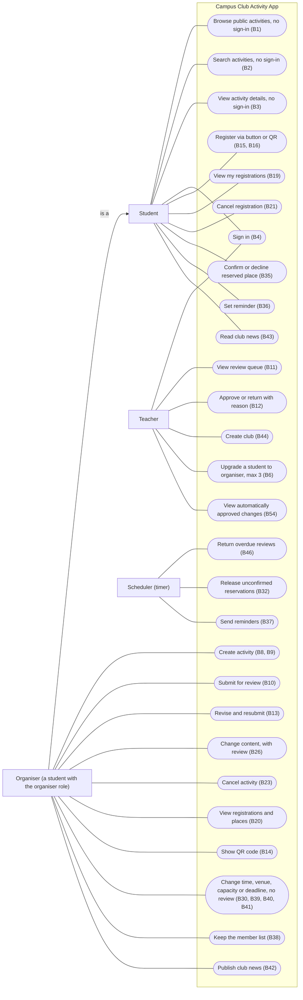

An organiser can do everything a student can ("is a"), plus the organiser use cases for their own clubs.

---

## 2a. Class diagram – users and clubs

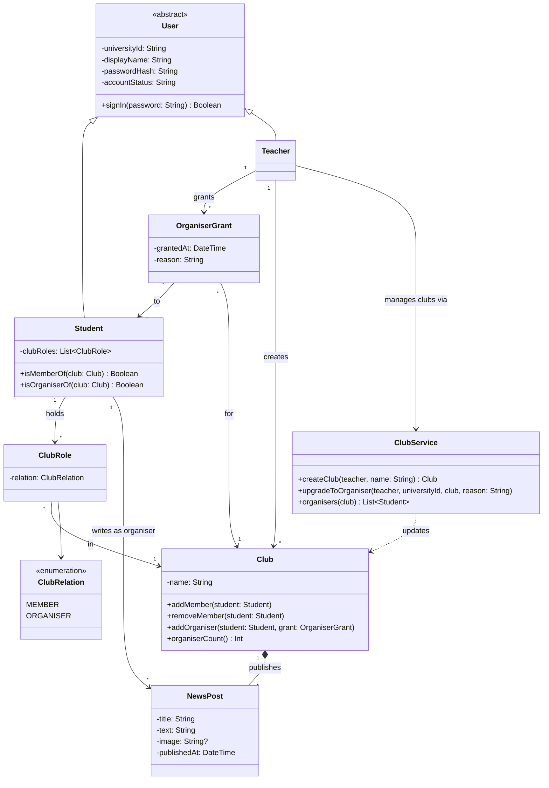

Rules:
- A club has at most 3 `ClubRole` with relation `ORGANISER` (B6). `addOrganiser()` refuses a 4th.
- A reason is required for every upgrade, and it is kept in `OrganiserGrant`.
- After the upgrade the student has both roles: student and organiser. No new account is needed.
- An organiser only manages activities, members (B38) and news (B42) of clubs they organise (B5). News needs no review.
- Club-only activities can only be seen and joined by members (B7).
- Teachers are not linked to clubs for reviewing: every teacher reviews every club.

---

## 2b. Class diagram – activities, review and sign-up

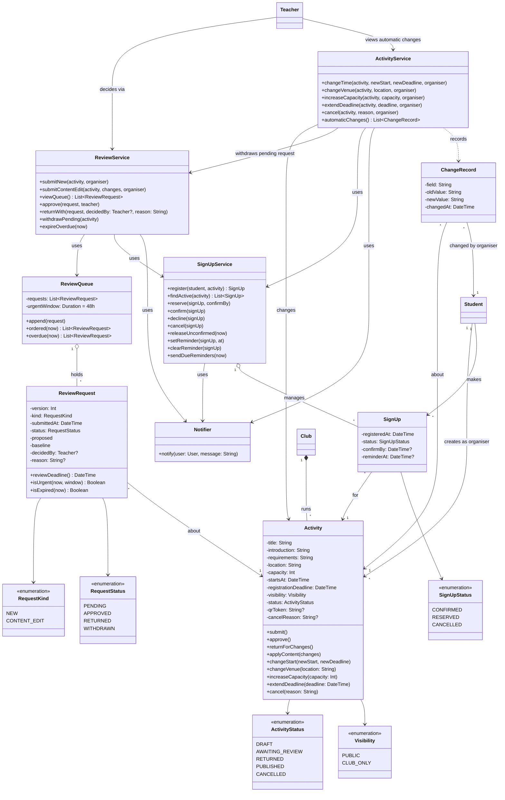

Design notes:
- **Method A**: `ActivityService` (changes without review) and `ReviewService` (reviewed submissions) coordinate. `Activity` has no link to `SignUp`.
- `reviewDeadline()`: NEW = the registration deadline or start − 12h, whichever is earlier. CONTENT_EDIT = start − 12h. Always from the current activity.
- `proposed` of a CONTENT_EDIT holds only the changed content fields.
- `changeTime()` is refused later than 48h before the old or the new start, whichever is earlier (B34). If the registration deadline is no longer before the new start, a new deadline is required (B30).
- A start time change makes every active sign-up `RESERVED` with `confirmBy` = new start − 24h. If it moves the start to or before `reminderAt`, the reminder is removed and the student is told (B36).
- A venue, capacity, deadline or content change leaves sign-ups as they are (B28).
- Students are notified at once of a time or venue change, and after approval of a content change (B29).
- Queue order: requests within 48h of `reviewDeadline` first, sorted by earliest deadline; others FIFO.
- `returnWith(reason: String)` – a reason is always required. `decidedBy = null` means the system returned it; the UI shows "Returned by: System".
- One `PENDING` request per activity at a time.
- Cancelling an activity marks its pending request `WITHDRAWN` and cancels all sign-ups.
- `version` and `baseline` let the teacher compare a new version with the approved one.
- `ChangeRecord` is only for changes made without review (B54).
- A student has at most one `SignUp` per activity (B18). Registering again returns the existing booking.
- Registration closes at the registration deadline or 12h before start, whichever is first, or when no places remain (B17).
- A `RESERVED` place still counts against capacity until it is confirmed or released (B30).

---

## 3. State diagram – Activity

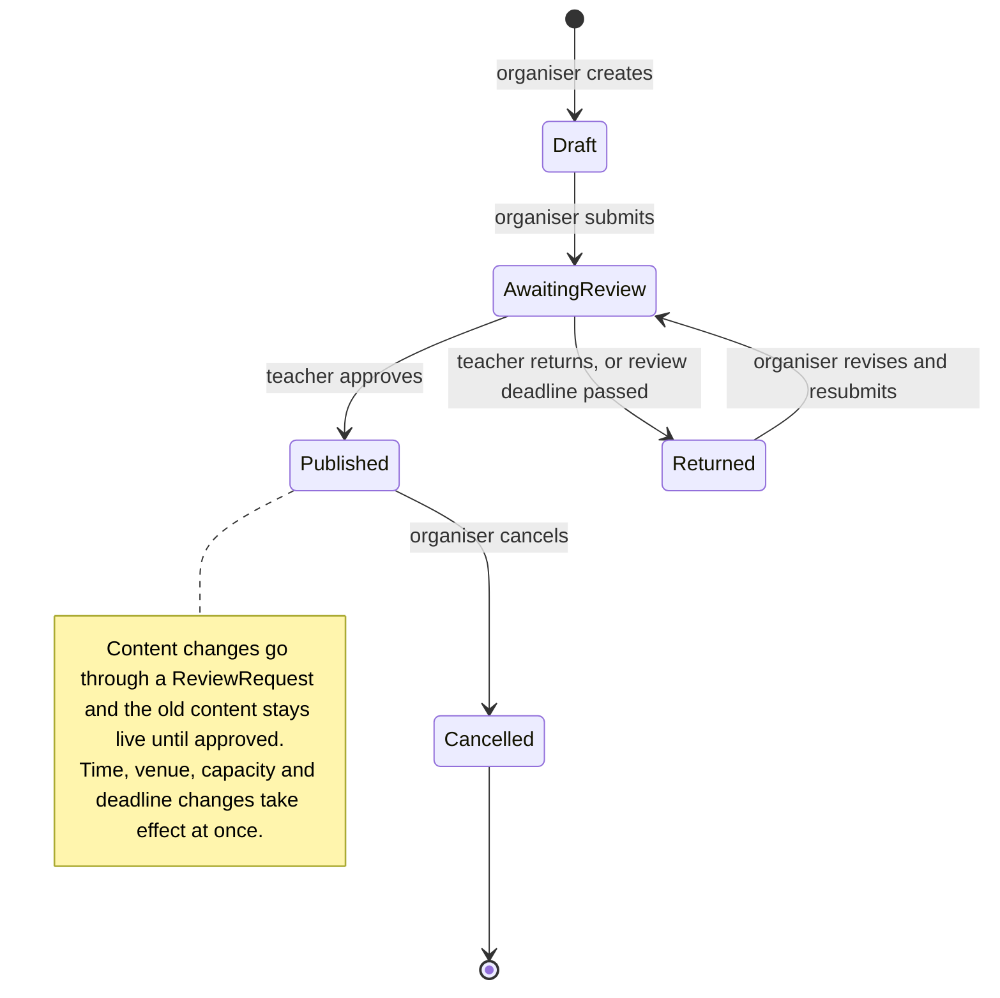

## 4. State diagram – ReviewRequest

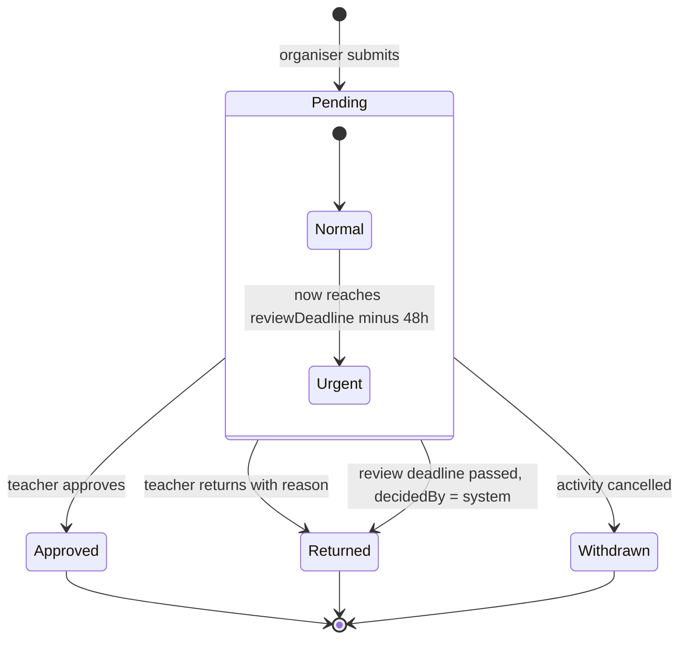

## 4b. State diagram – SignUp

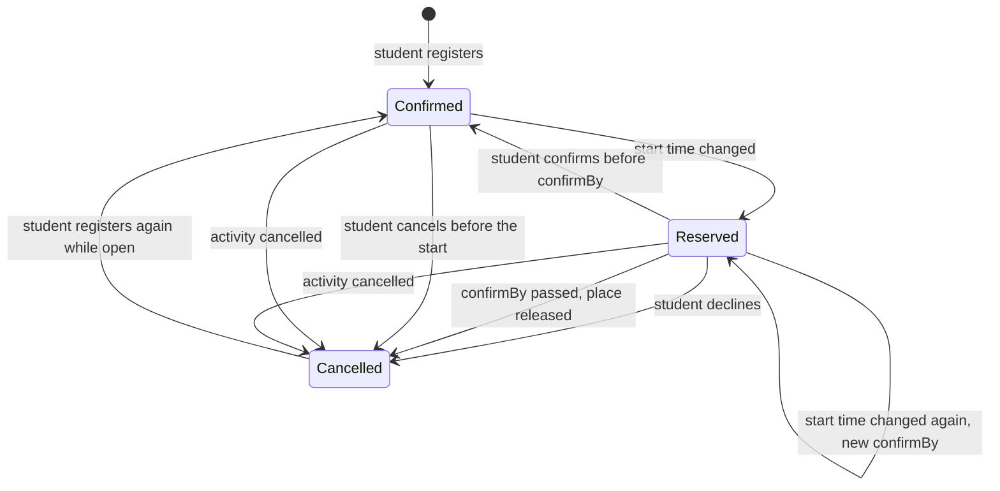

Every move to Cancelled releases the place (B22). The student is told when an unconfirmed place is released (B33).

---

## 5. Sequence diagram – start time change, no review (B30, B34, B35)

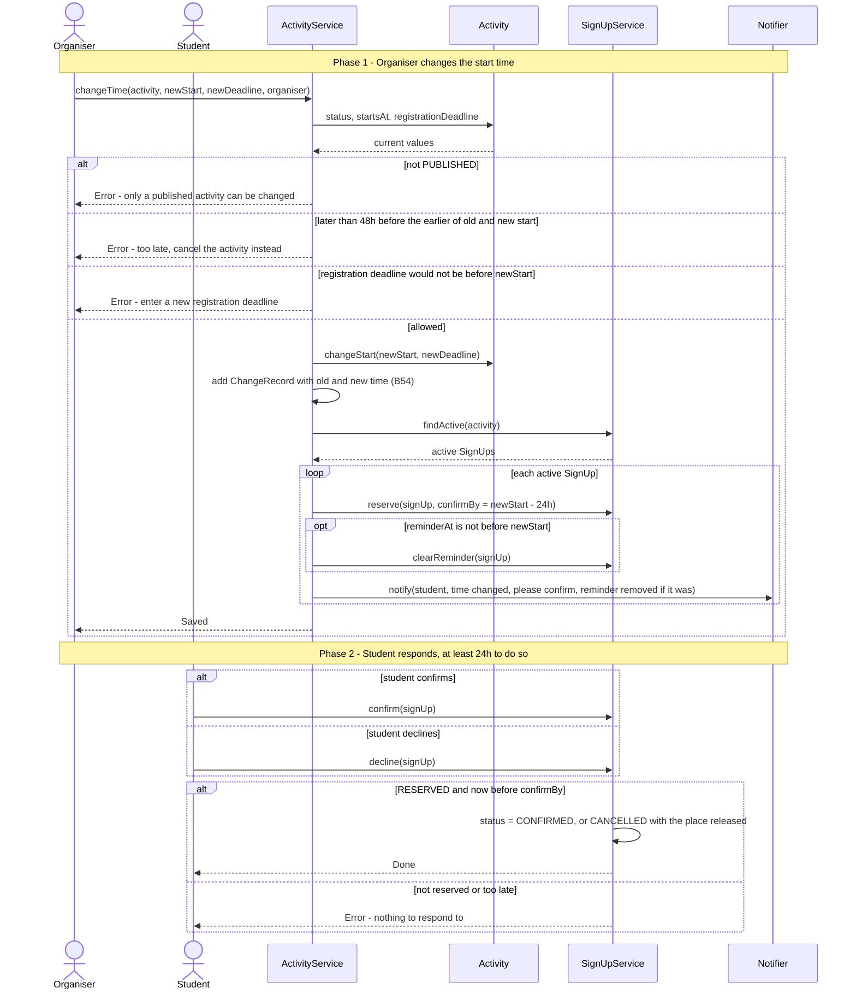

Venue, capacity and deadline changes follow Phase 1 without the 48h check and without `reserve()`. Each one applies its own rule from the design decisions and adds a `ChangeRecord`. Only a venue change must also notify every student at once.

## 5b. Sequence diagram – content change with review (B26, B27, B29)

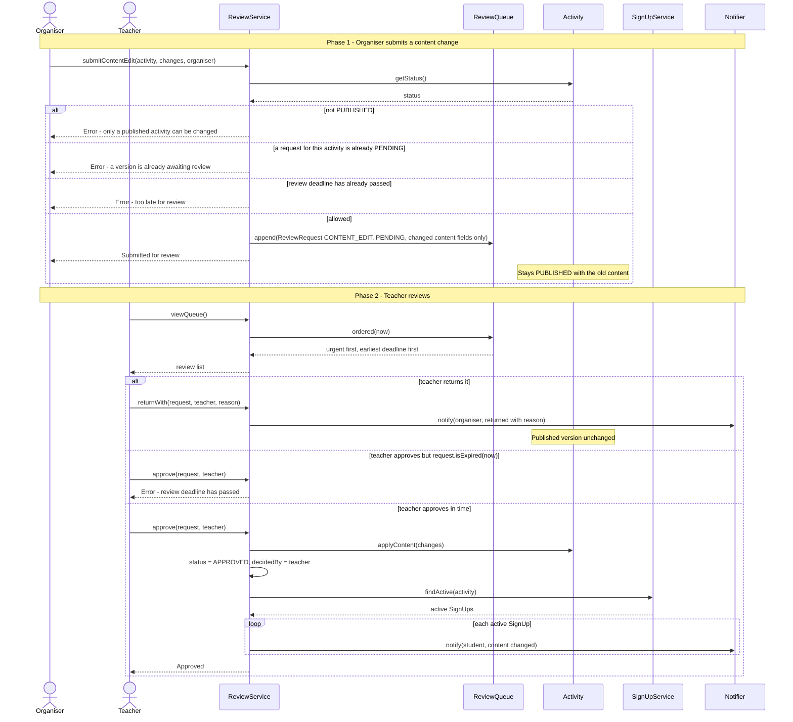

## 6. Sequence diagram – scheduler: unconfirmed places, reminders and overdue reviews (B32, B33, B37, B46)

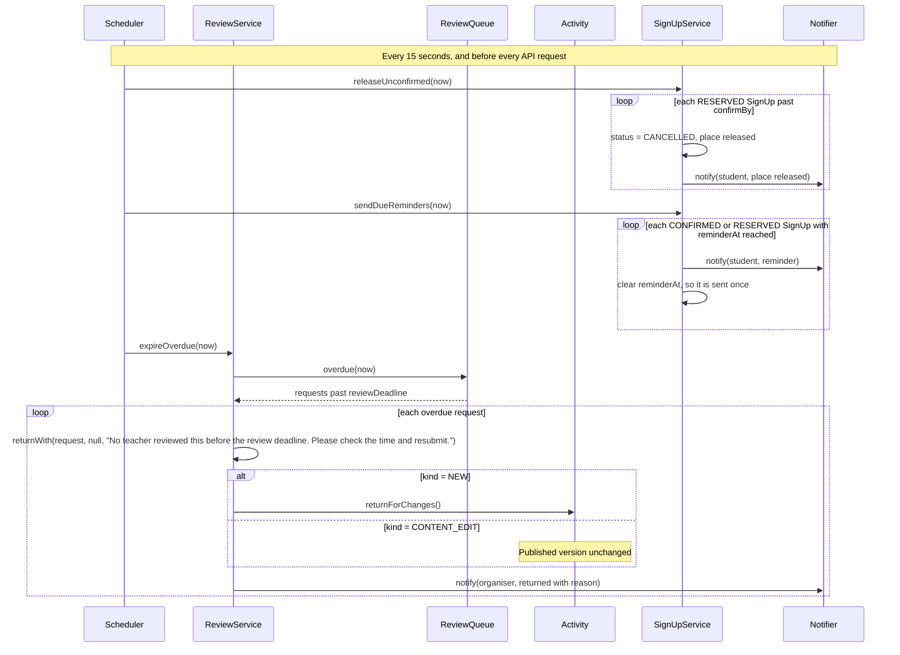

## 7. Sequence diagram – teacher upgrades a student to organiser (B6)

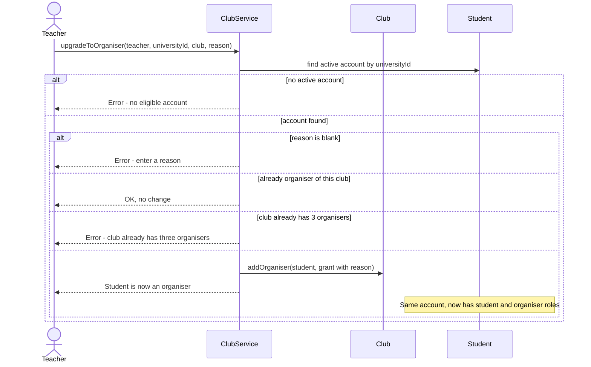

## 8. Sequence diagram – student registers via button or QR (B15–B18)

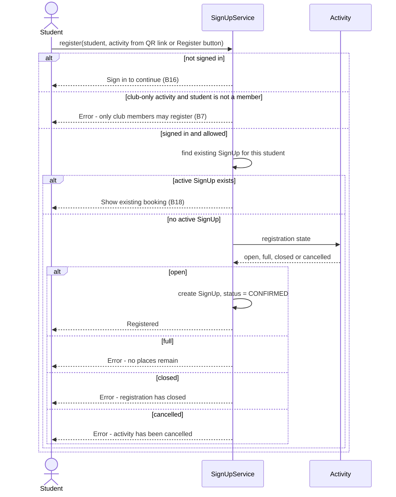
