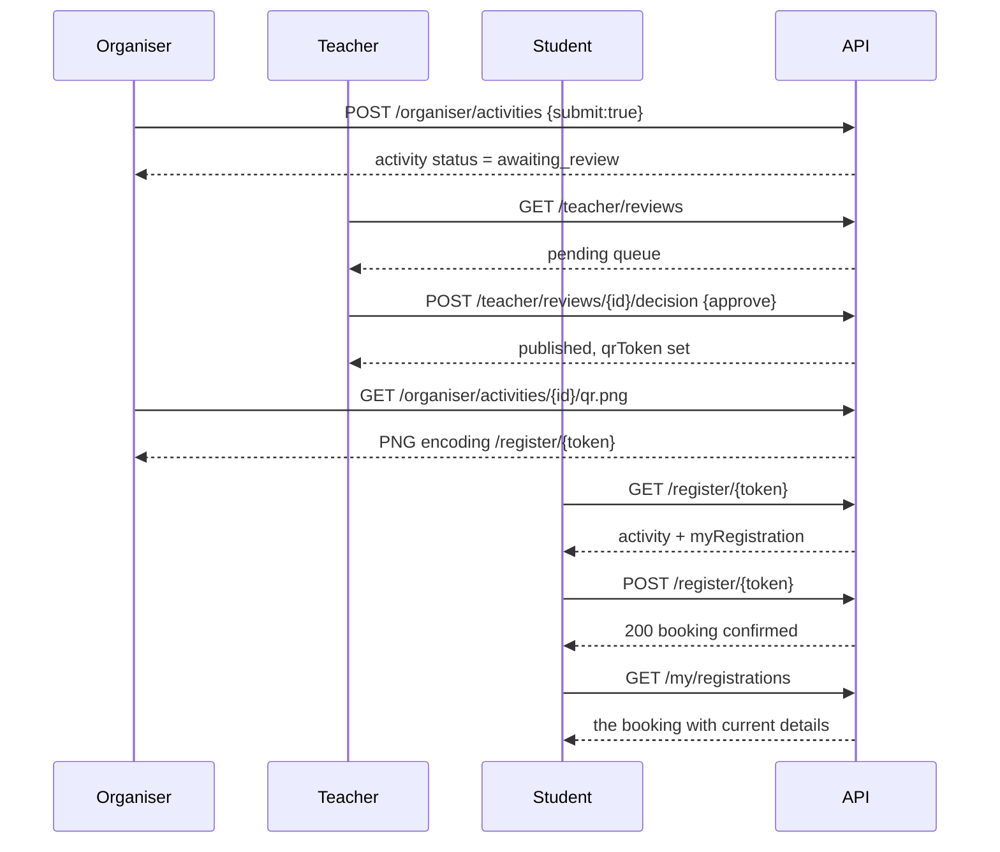

# API Reference

Every endpoint lives under `/api` and speaks JSON. Authentication is a **cookie session**, not a
token in a header. All error responses share one shape:

```json
{ "error": "FULL", "message": "No places remain.", "fields": { "capacity": "..." } }
```

`fields` is present only for validation failures. The client turns this into an `ApiError` with
`status`, `message` and `fields` (see `frontend/src/api/index.ts`).

> This page is the replacement for the `docs/api-contract.md` that the backend and frontend
> READMEs both link to. It is written from `backend/src/campus/**/*Routes.kt`, so it describes what
> the server actually serves.

## 1. Authentication

| Method | Path | Body | Result |
|---|---|---|---|
| `POST` | `/api/signup` | `{ universityId, displayName, password }` | `201` + user, and a session cookie |
| `POST` | `/api/login` | `{ universityId, password }` | `200` + user, and a session cookie |
| `POST` | `/api/logout` | — | `200 { "signedOut": true }`, cookie cleared |
| `GET` | `/api/me` | — | `200` + user, or `401 NOT_SIGNED_IN` |

The cookie is named `club_session`: `HttpOnly`, `SameSite=Lax`, `Path=/api`, 8-hour lifetime,
`Secure` when the request arrived over HTTPS. Signup always creates a **student**; a `role` field in
the body is ignored.

`GET /api/me` returns `{ userId, universityId, displayName, role, roles }`, where `roles` includes
any extra club roles.

**Write requests are origin-checked.** A non-GET request whose `Origin` header is present and does
not match `PUBLIC_BASE_URL` is refused with `403 FORBIDDEN`.

## 2. Public and student

| Method | Path | Purpose |
|---|---|---|
| `GET` | `/api/activities?q=&date=` | Published activities. `q` matches the title, `date` matches the local start date (`YYYY-MM-DD`) |
| `GET` | `/api/activities/{id}` | One activity, including `registrationState` and `myRegistration` |
| `GET` | `/api/register/{token}` | Resolve a QR token — the landing page for a scanned code |
| `POST` | `/api/register/{token}` | Confirm a booking. **Idempotent** |
| `GET` | `/api/my/registrations` | My bookings, upcoming first |
| `GET` | `/api/my/registrations/{id}` | One booking. Not mine → `404` |
| `POST` | `/api/my/registrations/{id}/cancel` | Cancel; `TOO_LATE` inside 24 h of the start |
| `POST` | `/api/my/registrations/{id}/confirm` | Accept a reserved place after a time change |
| `POST` | `/api/my/registrations/{id}/decline` | Decline it and release the place |
| `PUT` | `/api/my/registrations/{id}/reminder` | `{ reminderAt: ISO }`, or `{ reminderAt: null }` to clear |
| `GET` | `/api/my/notices` | In-app notices for this student |

Browsing needs no session; `/api/register/{token}` and everything under `/api/my` require one and
return `401 NOT_SIGNED_IN` otherwise.

### The activity object

```json
{
  "activityId": "act_7f3a",
  "clubId": "guitar",
  "clubName": "Guitar Club",
  "title": "Open rehearsal",
  "description": "Join our practice.",
  "location": "Room A",
  "requirements": "Bring an instrument.",
  "capacity": 20,
  "startsAt": "2030-05-05T12:00:00Z",
  "registrationDeadline": "2030-05-05T10:00:00Z",
  "visibility": "public",
  "status": "published",
  "remaining": 3,
  "confirmedCount": 16,
  "reservedCount": 1,
  "registrationState": "open",
  "myRegistration": { "registrationId": "reg_91", "status": "confirmed" },
  "cancelReason": null
}
```

`registrationState` is one of `open`, `full`, `closed`, `cancelled`. It is **derived** on every
read, never stored:

| State | Condition |
|---|---|
| `cancelled` | the activity is cancelled |
| `closed` | not published, **or** now ≥ the registration deadline, **or** now ≥ start − 12 h |
| `full` | no places left |
| `open` | otherwise |

Note the order: `closed` is checked before `full`, so a full activity that has also passed its
deadline reports `closed`.

## 3. Organiser

All of these require the organiser role **and** ownership of the activity's club; another club's
activity returns `403 FORBIDDEN` or `404 NOT_FOUND`.

| Method | Path | Purpose |
|---|---|---|
| `GET` | `/api/organiser/clubs` | The clubs I organise |
| `GET` | `/api/organiser/activities` | My activities, with status and counts |
| `POST` | `/api/organiser/activities` | Create. `{ ...fields, submit: true\|false }` |
| `GET` | `/api/organiser/activities/{id}` | Manage view: status, feedback, QR token, counts, pending edit |
| `PUT` | `/api/organiser/activities/{id}` | Edit a **draft or returned** activity |
| `POST` | `/api/organiser/activities/{id}/submit` | Submit a draft or resubmit a returned one |
| `POST` | `/api/organiser/activities/{id}/edits` | Propose a change to a **published** activity (files a review) |
| `GET` | `/api/organiser/activities/{id}/participants` | Participants with **name and university ID** |
| `POST` | `/api/organiser/activities/{id}/cancel` | `{ reason }` — cancels at once, no review |
| `GET` | `/api/organiser/activities/{id}/qr.png` | The QR code as a PNG, encoding `{PUBLIC_BASE_URL}/register/{token}` |

### What `POST .../edits` accepts

Only these four fields:

| Field | Rule |
|---|---|
| `location` | any change |
| `capacity` | **increase only** — a smaller value is refused |
| `registrationDeadline` | **later only** — an earlier value is refused |
| `startsAt` | any change, but see the note below |

Sending an unchanged object, or changing `title`, `description`, `requirements` or `visibility`,
returns `422` with "Change the venue, time, capacity or deadline."

> **Known divergence.** The design splits these two ways round: **content** (title, introduction,
> requirements, visibility) is supposed to need review (B26), while **venue, capacity, deadline and
> time** are supposed to take effect at once (B39–B41, B30). The implementation files the second
> group for review and rejects the first group entirely — so a published activity's title and
> description cannot be edited at all. See
> [Design Decisions](Design-Decisions#2-reconciliation--design-versus-code).

## 4. Teacher

| Method | Path | Purpose |
|---|---|---|
| `GET` | `/api/teacher/clubs` | The clubs I supervise |
| `POST` | `/api/teacher/clubs` | `{ clubName }` — create a club; I become its teacher |
| `GET` | `/api/teacher/clubs/{id}/organisers` | The organiser roster |
| `GET` | `/api/teacher/clubs/{id}/organisers/candidate?universityId=` | Look up an account to promote |
| `POST` | `/api/teacher/clubs/{id}/organisers` | `{ universityId, reason }` — grant organiser access |
| `GET` | `/api/teacher/reviews?sort=submitted\|deadline` | Pending queue for **my** clubs |
| `GET` | `/api/teacher/reviews/{id}` | One review, with the diff and `canApprove` |
| `POST` | `/api/teacher/reviews/{id}/decision` | `{ decision: "approve"\|"return", reason }` |
| `GET` | `/api/teacher/history` | Reviews I have decided |

### The review object

```json
{
  "reviewId": "rev_12",
  "activityId": "act_7f3a",
  "clubName": "Guitar Club",
  "title": "Open rehearsal",
  "version": 2,
  "kind": "edit",
  "status": "pending",
  "submittedBy": "Jiaxin Liu",
  "submittedAt": "2030-05-01T09:00:00Z",
  "proposed": { "...": "the submitted fields" },
  "previous": { "...": "the baseline fields" },
  "changedFields": ["location", "startsAt"],
  "previousFeedback": { "reason": "Add the room number." },
  "isTimeChange": true,
  "canApprove": false,
  "blockReason": "TOO_CLOSE_TO_START",
  "decision": null
}
```

- `kind` is `new` or `edit`.
- `canApprove` is computed on the server; when it is `false`, `blockReason` explains why and the
  interface must disable the approve button.
- The only current `blockReason` is `TOO_CLOSE_TO_START`: a **time change** whose new start is less
  than 24 h away. Approving anyway returns `409 TOO_CLOSE_TO_START`.

### What approval does

| `kind` | Effect |
|---|---|
| `new` | `status = published`, a `qrToken` is generated |
| `edit`, time unchanged | the proposed fields replace the current ones; bookings stay confirmed |
| `edit`, time changed | as above, and every active booking becomes `reserved` with a confirmation deadline 24 h before the new start; students are notified |

Every decision stores `reviewerId`, `decidedAt`, `reason` and the version it applied to.

## 5. Error codes

| Code | Status | Meaning |
|---|---|---|
| `NOT_SIGNED_IN` | 401 | No valid session |
| `INVALID_LOGIN` | 401 | Wrong university ID or password |
| `FORBIDDEN` | 403 | Wrong role, another club's data, or a bad `Origin` |
| `NOT_MEMBER` | 403 | Club-only activity, and the student is not a member |
| `NOT_FOUND` | 404 | No such activity, booking or review |
| `ID_IN_USE` | 409 | That university ID already has an account |
| `CLUB_NAME_IN_USE` | 409 | Duplicate club name |
| `FULL` | 409 | No places remain |
| `CLOSED` | 409 | Past the deadline, or inside 12 h of the start |
| `CANCELLED` | 409 | The activity was cancelled |
| `TOO_LATE` | 409 | Cancelling inside 24 h of the start |
| `ALREADY_DECIDED` | 409 | This review is no longer pending |
| `PENDING_REVIEW` | 409 | A version is already awaiting review |
| `NOT_EDITABLE` | 409 | The activity's status forbids this edit |
| `NOT_CONFIRMED` | 409 | A reminder needs a confirmed booking |
| `NOT_RESERVED` | 409 | Nothing to confirm or decline |
| `TOO_CLOSE_TO_START` | 409 | Approving a time change inside 24 h of the new start |
| `ORGANISER_LIMIT` | 409 | The club already has three organisers |
| `NO_ELIGIBLE_ACCOUNT` | 422 | No active account for that university ID |
| `REASON_REQUIRED` | 422 | Returning a review, or granting access, needs a reason |
| `VALIDATION_FAILED` | 422 | Field errors in `fields` |
| `INVALID_REMINDER_TIME` | 422 | The reminder is not in the future and before the start |
| `BAD_REQUEST` | 400 | Malformed JSON or a missing path parameter |

## 6. Integration flow

For a client that wants to walk the whole happy path:


