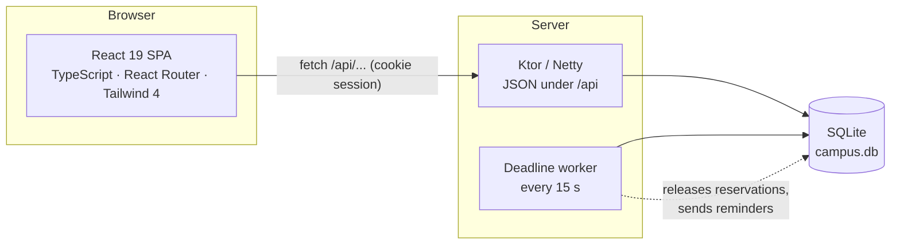

# Architecture

## 1. Shape of the system

The frontend and backend are **separate applications** that speak JSON over HTTP. The browser
never sees a server-rendered page.



In development Vite proxies `/api` to Ktor, so both are on one origin and no CORS configuration is
needed. In production the SPA is built and its static files are served next to the API.

## 2. Why this shape

The team originally planned a server-rendered Pebble application. It was replaced because the
student side is phone-first and highly interactive: registration states, live place counts,
reminders and confirmation dialogs. A React SPA models that better, and a JSON API keeps the three
role interfaces independent.

The consequence that matters: **`docs/api-contract.md`-style discipline is mandatory**. The API is
the only contract between the two halves, so it is documented on [API Reference](API-Reference) and
the frontend reaches it through exactly one module.

## 3. Backend layout

```
backend/
├── module.yaml              dependencies, main class (Amper build)
├── kotlin / kotlin.bat      bundled toolchain wrapper — no hand-written Gradle
├── resources/
│   ├── schema.sql           eight tables, three indexes, one trigger
│   ├── seed.sql             clubs, demo accounts, club roles
│   └── logback.xml
├── src/campus/
│   ├── Application.kt       installs plugins, mounts /api, starts the worker
│   ├── auth/                login, sessions, role and club permission checks
│   ├── student/             routes and service for browsing and booking
│   ├── organiser/           routes and service for creating and managing activities
│   ├── teacher/             routes and service for the review queue and clubs
│   ├── activities/          shared rules: fields, capacity, time, cancellation, due work
│   ├── db/                  JDBC transactions, schema loading
│   └── http/                JSON replies, error mapping, request helpers
└── test/WorkflowTest.kt     seven end-to-end API scenarios
```

### Request path

```mermaid
sequenceDiagram
    participant B as Browser
    participant R as Route
    participant A as Api
    participant T as Transaction
    participant D as SQLite

    B->>R: GET /api/activities
    R->>A: api.reply(call) { browse(...) }
    A->>A: read session cookie
    A->>T: db.transaction { processDue(); block() }
    Note over T: processDue() runs first,<br/>so deadlines hold even after downtime
    T->>D: queries
    D-->>T: rows
    T-->>A: JsonElement
    A-->>B: 200 application/json
```

Two things are worth noticing:

1. **`processDue()` runs inside every transaction**, not only in the worker. A reservation that
   expired while the server was off is released before the request that would have observed it.
2. **Every role check happens on the server.** `api.role(call, "teacher")` rejects the request
   before the service function is reached. Hiding a button in React is presentation, not access
   control.

### Plugins

Ktor is configured in small `configure*`-style blocks rather than one long `Application.module`:

| Plugin | Purpose |
|---|---|
| `ContentNegotiation` | `kotlinx.serialization` JSON |
| `StatusPages` | maps `ApiError` to `{ "error", "message", "fields" }` |
| CORS / origin check | rejects a write whose `Origin` is not the configured frontend |
| `routing` | mounts `authRoutes`, `studentRoutes`, `organiserRoutes`, `teacherRoutes` under `/api` |

## 4. Frontend layout

```
frontend/
├── index.html
├── vite.config.ts        dev server on 5173, proxies /api to Ktor
└── src/
    ├── main.tsx          router, layout, route guards
    ├── shared.tsx        reusable pieces: field, status badge, empty state, flash
    ├── style.css         Tailwind entry and design tokens
    ├── api/index.ts      ← the only module that calls the backend
    └── pages/
        ├── Board.tsx                public activity list and detail
        ├── Student.tsx              registrations, cancellation, reminders
        ├── Organiser.tsx            my activities, form, manage, cancel
        ├── Teacher.tsx              review queue, review detail, history
        └── TeacherOrganisers.tsx    clubs and organiser grants
```

### The single data-access module

All network traffic goes through `frontend/src/api/index.ts`. It exports:

- the **types** that mirror the API (`Activity`, `Booking`, `Review`, `Participant`, `Notice`),
- `api<T>(path, method, body)` — one `fetch` wrapper that turns a non-2xx response into a typed
  `ApiError` carrying `status` and per-field `fields`,
- `useData<T>(path)` — a small loading/error/data hook with an `AbortController`.

Because there is exactly one place where `fetch` appears, changing a field name or an endpoint
touches one file. That is also why `useData` returns `{ key }` with no data while a request is in
flight: every page gets loading, error and empty states for free rather than by remembering to
write them.

### Routes

| Path | Page | Access |
|---|---|---|
| `/activities`, `/activities/:id` | Board | Public |
| `/login`, `/signup` | Account form | Public |
| `/register/:token` | Registration confirm | Student |
| `/my/registrations`, `/my/registrations/:id` | My registrations | Student |
| `/organiser/activities`, `/new`, `/:id`, `/:id/edit` | My activities | Organiser |
| `/teacher/reviews`, `/teacher/reviews/:id`, `/teacher/history` | Review queue | Teacher |
| `/teacher/clubs/new`, `/teacher/organisers` | Manage clubs | Teacher |

Route guards in `main.tsx` redirect an unauthenticated visitor to `/login` and return them to the
page they wanted afterwards, which is what makes a scanned QR link work for a signed-out student.

## 5. Design tokens

Colour, type scale, spacing, radius and the focus ring live in the Tailwind theme as CSS variables,
not as ad-hoc classes. Pages compose tokens; they do not invent colours. This keeps the three role
interfaces visually consistent and makes the contrast requirement (4.5:1) checkable in one place.

## 6. Testing

| Layer | Tool | What it covers |
|---|---|---|
| Backend | Kotest `FreeSpec` + Ktor `testApplication` | Seven end-to-end scenarios against a temporary SQLite file |
| Frontend | `tsc --noEmit` + `vite build` | Type correctness and a production build |

The backend tests are deliberately scenario-shaped rather than unit-shaped, because the rules that
matter (the last place, the review window, reservation expiry) only exist once several services and
the database are in play. A `TestClock` lets a scenario jump to 2030 and assert that a deadline
really fires.

The scenarios are listed on [Setup and Run](Setup-and-Run#6-tests).
