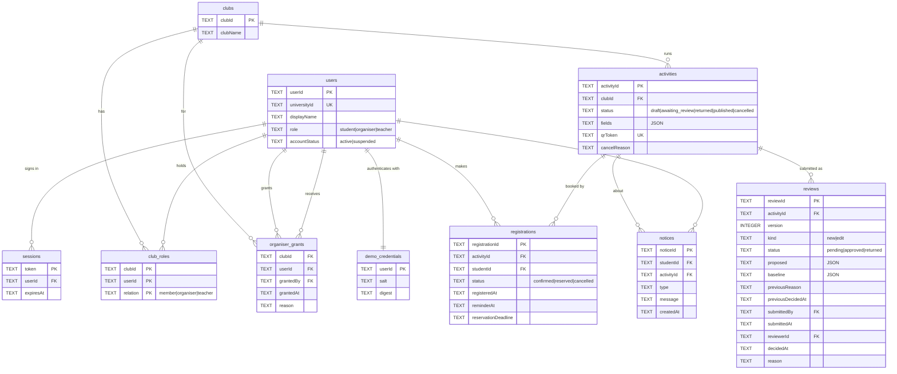

# Database Design

One SQLite file, eight tables, three indexes and one trigger. The schema lives in
`backend/resources/schema.sql` and is applied on start-up; `seed.sql` adds the demo clubs,
accounts and club roles.

## 1. Entity relationships



## 2. Table by table

### `users`

One row per account. `role` is the **primary** role; the extra roles a student accumulates as an
organiser live in `club_roles`, not as a second account. That is the database expression of design
decision 1 on [Design Decisions](Design-Decisions).

`universityId` is `UNIQUE` and compared case-insensitively for ASCII letters, so `s001` and `S001`
are the same person.

### `clubs` and `club_roles`

`club_roles` is a three-column join table whose primary key is the whole triple
`(clubId, userId, relation)`. A person can therefore be a `member` **and** an `organiser` of the
same club, and a `teacher` of several clubs, without duplicate-key trouble.

The three-organiser limit is enforced by a **trigger**, not by application code:

```sql
CREATE TRIGGER IF NOT EXISTS limit_organisers BEFORE INSERT ON club_roles
WHEN NEW.relation='organiser'
 AND NOT EXISTS(SELECT 1 FROM club_roles WHERE clubId=NEW.clubId AND userId=NEW.userId AND relation='organiser')
 AND (SELECT count(*) FROM club_roles WHERE clubId=NEW.clubId AND relation='organiser') >= 3
BEGIN SELECT RAISE(ABORT,'At most three organisers per club'); END;
```

Putting the rule in the database means no code path — a teacher's grant, the CLI command, a future
script — can bypass it. The `NOT EXISTS` clause is what makes a repeated grant idempotent instead
of counting against the limit.

### `sessions`

Server-side sessions, not JWTs. The cookie is `HttpOnly`, `SameSite=Lax`, path `/api`, eight-hour
lifetime, and `Secure` when the request arrived over HTTPS. Because sessions are rows, signing out
is a `DELETE` and suspension can be enforced on every request rather than waiting for a token to
expire.

### `organiser_grants`

An audit row for every upgrade: who was promoted, in which club, by whom (`NULL` for a system
grant), when, and **why**. A reason is mandatory. This is the record that answers "who made this
person an organiser, and on what grounds".

### `activities`

The interesting decision is `fields TEXT NOT NULL` holding a JSON object with the activity's
content: title, description, location, requirements, capacity, start time, registration deadline
and visibility.

Two reasons:

1. **A review compares whole versions.** A `reviews` row stores `proposed` and `baseline` as JSON
   snapshots. Keeping the activity's content in the same shape means a comparison is a field-by-field
   diff of two JSON objects, with no per-column migration every time the form changes.
2. **Content changes are partial.** Design decision 7 says a content request stores *only* the
   changed fields, so approving it can never overwrite a newer start time, venue or capacity. A
   JSON object expresses "these keys, not those" naturally; a fixed set of columns does not.

`status` is a real column with a `CHECK` constraint because it drives routing and queries.
`qrToken` is `UNIQUE` and `NULL` until first approval — the token is a random string, never the
auto-increment id, so a registration link cannot be guessed by counting.

### `reviews`

One row per submitted version. `UNIQUE(activityId, version)` numbers the submissions of an
activity, and this partial index enforces design decision 11:

```sql
CREATE UNIQUE INDEX IF NOT EXISTS one_pending_review
    ON reviews(activityId) WHERE status='pending';
```

**Only one pending review per activity** — and the rule is enforced by the database, so two
simultaneous submissions cannot both succeed.

`baseline` holds the version the teacher is comparing against; `previousReason` and
`previousDecidedAt` carry the last feedback forward so a resubmission shows it. `reviewerId` is
nullable precisely so a system-issued return can be recorded with `decidedBy = NULL` and displayed
as "Returned by: System".

### `registrations`

`UNIQUE(activityId, studentId)` is the duplicate-booking rule from B18 in one constraint: a student
has at most one row per activity, and registering again finds that row instead of creating a second.

`status` distinguishes the three states that the UI needs:

| Status | Meaning | Counts against capacity |
|---|---|---|
| `confirmed` | A normal booking | Yes |
| `reserved` | A start time changed; awaiting the student's confirmation | **Yes** (B30) |
| `cancelled` | Cancelled, declined or expired | No |

`reservationDeadline` is the confirmation cutoff (new start − 24 h); `reminderAt` is the reminder
time. Both are absolute timestamps, so the worker can find due rows with a plain `WHERE <= ?`.

### `notices`

In-app notifications. Every rule that says "notify the student" writes a row here, and the frontend
reads them. The channel — in-app or email — is still an open decision, which is why the table stores
a `type` and a ready-made `message` rather than a template.

### `demo_credentials`

Salt and digest only, never a password. `PBKDF2WithHmacSHA256`, 120 000 iterations, 256-bit output,
16-byte random salt per account, compared with `MessageDigest.isEqual` to avoid a timing leak.

The name is honest: this is a **simulated** identity service for coursework. A real deployment
would delegate to the university's SSO and this table would not exist.

## 3. Indexes

| Index | Serves |
|---|---|
| `one_pending_review` (partial, unique) | One pending review per activity; the review queue |
| `student_bookings` on `registrations(studentId)` | "Registered Activities" |
| implicit `UNIQUE` on `(activityId, studentId)` | Duplicate-booking check and place counting |

## 4. What is deliberately not a table

- **`registrationState`** (`open` / `full` / `closed` / `cancelled`) is **derived**, never stored.
  It depends on the current time, the deadline, the start and the live place count, so storing it
  would mean keeping it correct on every clock tick. It is computed in `activities/Activity.kt` on
  the way out.
- **`remaining`** and the counts are derived the same way.
- **The review deadline** is computed from the activity's current times, never stored — design
  decision 9. A stored deadline would go stale the moment a start time changed.
- **`ChangeRecord`** for automatically approved changes (B54) is described in the UML but is not in
  the schema yet; it belongs to a later backlog item.
