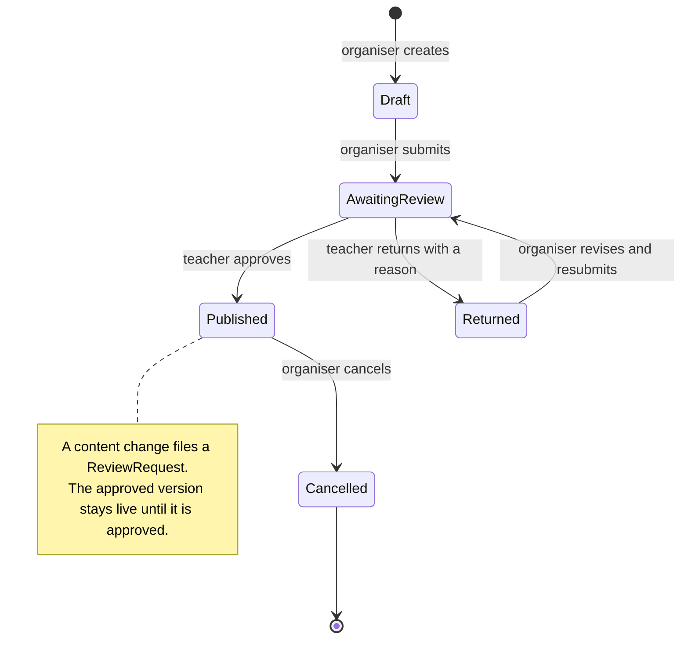
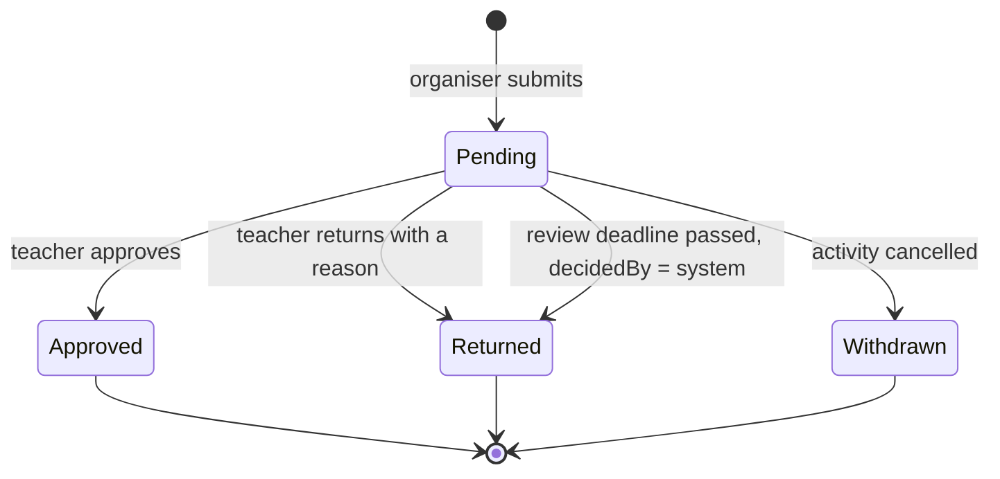
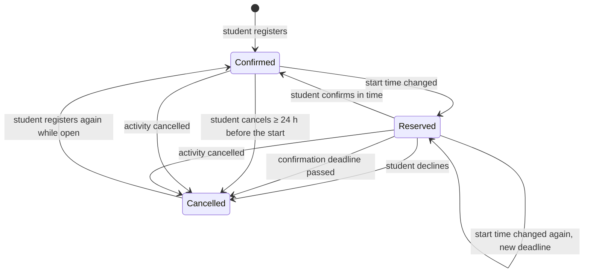
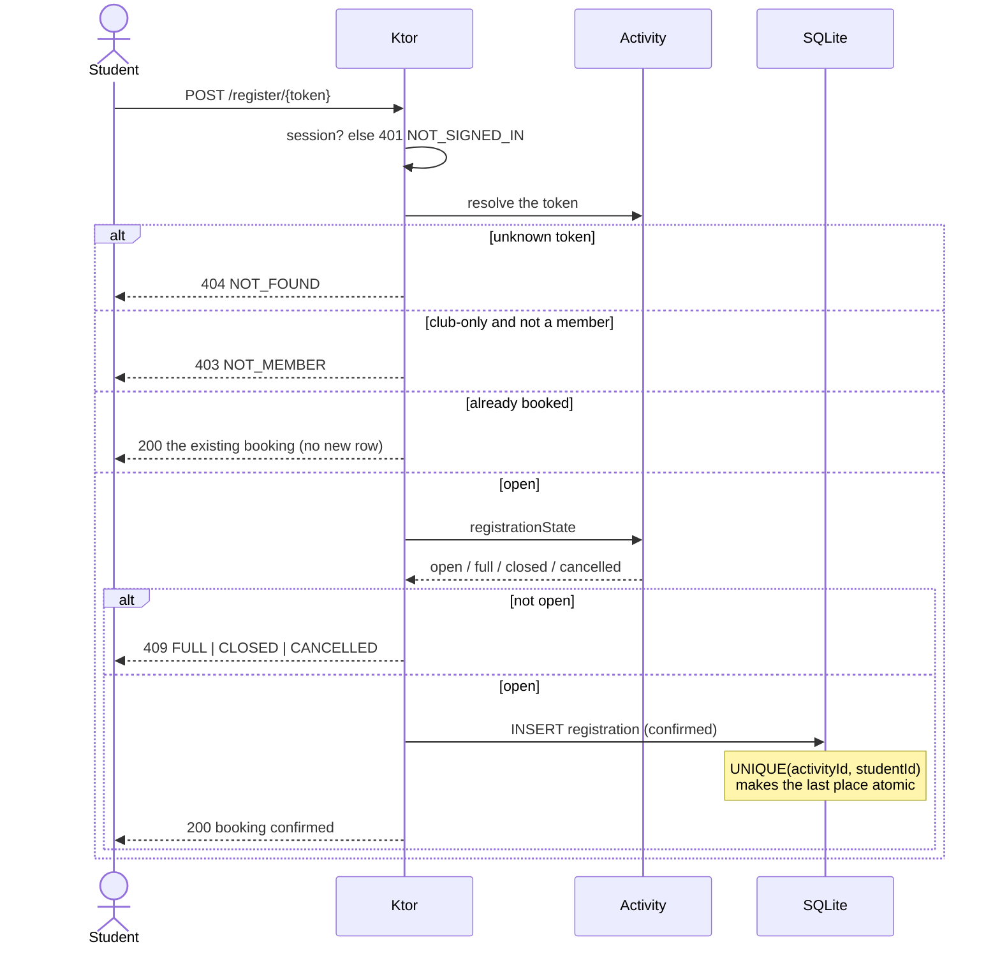
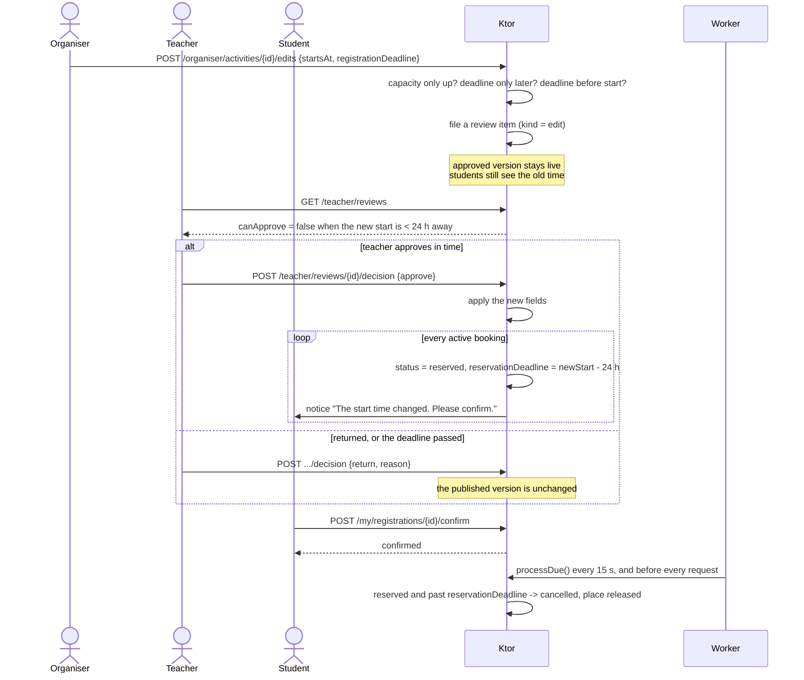
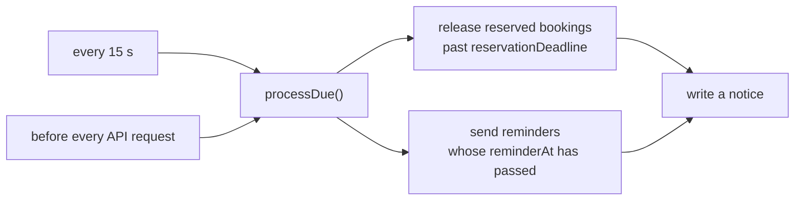
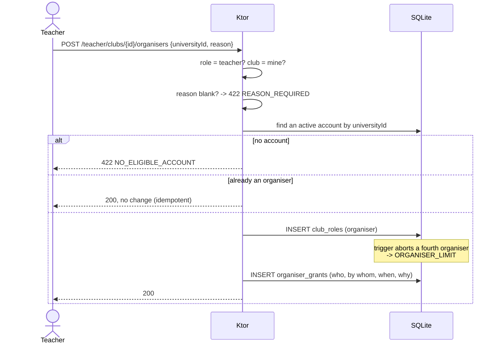

# Workflows

Three state machines and three flows that are easy to get wrong. The diagrams match
`docs/club-uml.md`; where the code differs, the difference is called out.

## 1. Activity status



Two things to keep straight:

- **`Returned` is called "Needs changes" in the interface.** The backlog and the UML use
  `returned`; one user-story document used "Needs Changes". The state is `returned`, the label is
  "Needs changes".
- **Cancelling is not a review action.** It takes effect at once, withdraws any pending review, and
  releases every booking.

## 2. Review request



Only **one** `Pending` request per activity exists at a time — enforced by a partial unique index,
not by a check in the service. A second submission gets `PENDING_REVIEW`.

## 3. Registration



Every move to `Cancelled` releases the place. A `Reserved` place still counts against capacity until
it is confirmed or released (B30) — otherwise a time change would let the activity be oversold while
students are deciding.

## 4. Registration, step by step



The last place is won by the `UNIQUE` constraint and a transaction, not by a count-then-insert in
application code. Two students racing get one success and one `FULL`.

## 5. Start-time change

This is the most involved flow in the project, because it touches all three roles and a timer.



### Where the code and the design disagree

| | Design | Code |
|---|---|---|
| Which fields need review? | **Content** — title, introduction, requirements, visibility (B26) | Only `location`, `capacity`, `registrationDeadline`, `startsAt` are accepted; content fields are refused |
| Does a start-time change need review? | No — takes effect at once (B30) | Yes — filed as an `edit` review item |
| 48 h cutoff (B34) | Refuse later than 48 h before the earlier of old and new start | Not implemented |
| 24 h approval block (B34) | Refuse approving inside 24 h of the new start | Implemented — `TOO_CLOSE_TO_START` |

The practical consequences, and they are serious:

- An organiser cannot change a published activity's **title or description at all**.
- An organiser cannot move an activity without a teacher, even though the backlog says they should
  be able to.
- The four fields that were meant to bypass review are the four that require it.

This is the most consequential divergence in the project, and it is written up on
[Revision Log § 3.1](Revision-Log#31-content-changes-are-not-reviewable) and
[Design Decisions](Design-Decisions#2-reconciliation--design-versus-code).

## 6. The worker



Running `processDue()` **inside each request's transaction** is what makes deadlines survive
downtime: after a restart, the first request to arrive applies everything that fell due while the
server was off, before it answers.

The worker deliberately does **not** handle overdue reviews, even though design decision 12 says it
should. `processDue()` covers reservations and reminders only; `B46` is not implemented. See
[Design Decisions](Design-Decisions#2-reconciliation--design-versus-code).

## 7. Cancellation

One function does all the work, and every caller goes through it:

```
closeActivity(activity, reason)
├── status = cancelled, cancelReason = reason
├── withdraw any pending review          (status = withdrawn)
└── for every booking that is not cancelled
    ├── write a "cancelled" notice with the reason
    └── release the booking
```

Because the QR code resolves the activity rather than a booking, a scanned code on a cancelled
activity lands on the cancellation message with no extra work. Because pending reviews are
withdrawn, a teacher cannot later approve an activity that no longer exists in public view.

## 8. Organiser promotion



The student keeps the same account and keeps their bookings; they gain the organiser interface on
their next request. The reason is stored, not just validated, so the grant is auditable.
